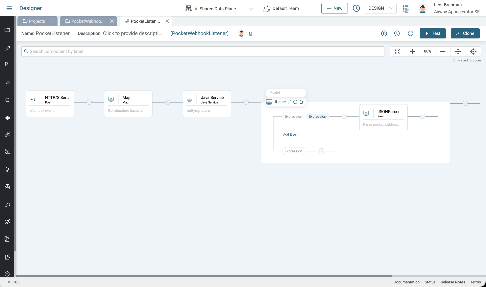
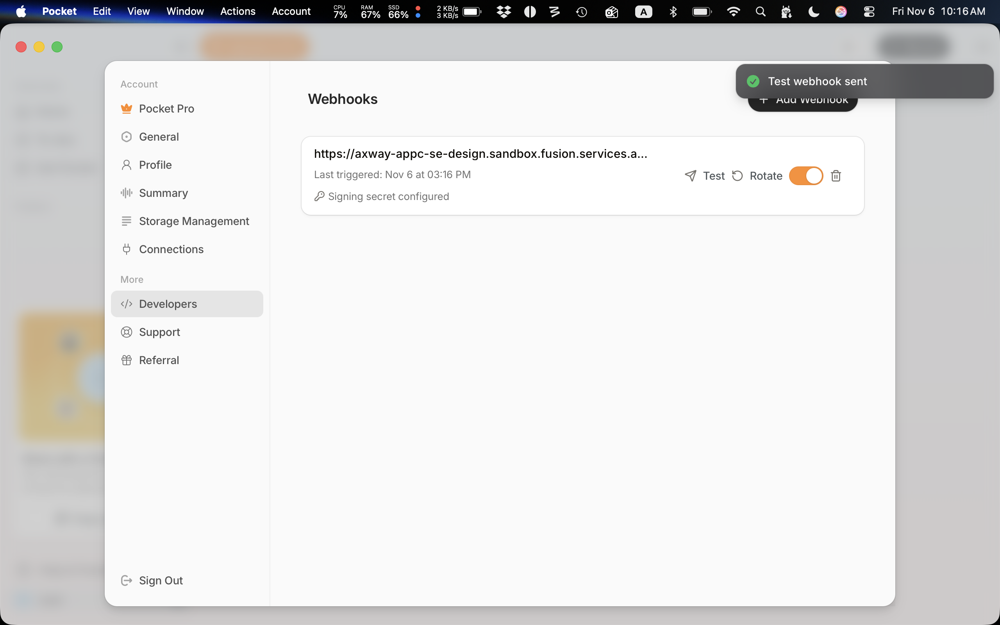
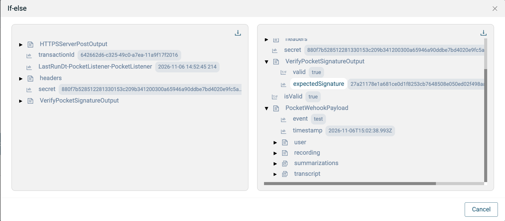

# Amplify Fusion Pocket Personal AI Assistant Webhook Handler

An Amplify Fusion webhook listener exmaple project for the [Pocket](https://heypocket.com/) personal AI assistant.

Pocket webhooks are described in the [developer online docs](https://docs.heypocketai.com/docs/api/webhooks). Webhooks can be optionally verified using HMAC-SHA256 and comparing the the webhook secret.

In this Amplify Fusion example project the verifier is implemented using a Java Service with whitelisted classes so it can run on shared data planes.

## Getting Started

* Import the Amplify Fusion project export in this repo into your Fusion tenant
* Enable the HTTP Server Post integration and copy the URL
* Disable the integration
* Launch your Pocket Desktop app and create a webhook using this URL and copy the secret
* Edit the integration and set your secret
* Enable the integration
* Test the webhook from the Pocket Desktop app and see a successful send
* Go to the Fusion Monitor and view the transaction details to see the validation service and webhook payload

## Java Service

The Java Service is in the project but the code is also shown below:

```java
import java.util.*;
// Please do not change pre-populated code.
public class PocketListener_VerifyPocketSignature {

    public Map<String,Object> execute(Map<String,Object> dataIn) {
        Map<String,Object> dataOut = new HashMap<String, Object>();

/* Please start your code here */
        try {
            Object secretObj = dataIn.get("secret");
            Object timestampObj = dataIn.get("timestamp");
            Object bodyObj = dataIn.get("body");
            Object signatureObj = dataIn.get("signature");

            if (secretObj == null || timestampObj == null || bodyObj == null || signatureObj == null) {
                dataOut.put("valid", false);
                dataOut.put("error", "Missing input: secret, timestamp, body and signature are all required");
                return dataOut;
            }

            String secret = secretObj.toString();
            String timestamp = timestampObj.toString();
            String body = bodyObj.toString();
            String signature = signatureObj.toString().trim();
            String message = timestamp + "." + body;

            // ------------------------------------------------------------------
            // Pure-Java HMAC-SHA256 (RFC 2104 + FIPS 180-4).
            // The Fusion sandbox blocks javax.crypto, MessageDigest, DatatypeConverter
            // and array property access, so everything uses Lists, Strings and longs.
            // ------------------------------------------------------------------
            final long MASK = 0xFFFFFFFFL;
            final String HEX = "0123456789abcdef";
            final String K_HEX =
                "428a2f9871374491b5c0fbcfe9b5dba53956c25b59f111f1923f82a4ab1c5ed5" +
                "d807aa9812835b01243185be550c7dc372be5d7480deb1fe9bdc06a7c19bf174" +
                "e49b69c1efbe47860fc19dc6240ca1cc2de92c6f4a7484aa5cb0a9dc76f988da" +
                "983e5152a831c66db00327c8bf597fc7c6e00bf3d5a7914706ca635114292967" +
                "27b70a852e1b21384d2c6dfc53380d13650a7354766a0abb81c2c92e92722c85" +
                "a2bfe8a1a81a664bc24b8b70c76c51a3d192e819d6990624f40e3585106aa070" +
                "19a4c1161e376c082748774c34b0bcb5391c0cb34ed8aa4a5b9cca4f682e6ff3" +
                "748f82ee78a5636f84c878148cc7020890befffaa4506cebbef9a3f7c67178f2";
            final String H_HEX =
                "6a09e667bb67ae853c6ef372a54ff53a510e527f9b05688c1f83d9ab5be0cd19";

            List<Long> K = new ArrayList<Long>();
            for (int i = 0; i < 64; i++) {
                K.add(Long.parseLong(K_HEX.substring(i * 8, i * 8 + 8), 16));
            }

            // ---- UTF-8 encode secret (s=0) and message (s=1) into byte-value lists ----
            List<Integer> keyBytes = new ArrayList<Integer>();
            List<Integer> msgBytes = new ArrayList<Integer>();
            for (int s = 0; s < 2; s++) {
                String src = (s == 0) ? secret : message;
                List<Integer> dst = (s == 0) ? keyBytes : msgBytes;
                int idx = 0;
                while (idx < src.length()) {
                    int cp = src.codePointAt(idx);
                    idx += (cp >= 0x10000) ? 2 : 1;
                    if (cp >= 0xD800 && cp <= 0xDFFF) { cp = 0xFFFD; } // lone surrogate (matches Node)
                    if (cp < 0x80) {
                        dst.add(cp);
                    } else if (cp < 0x800) {
                        dst.add(0xC0 | (cp >> 6));
                        dst.add(0x80 | (cp & 0x3F));
                    } else if (cp < 0x10000) {
                        dst.add(0xE0 | (cp >> 12));
                        dst.add(0x80 | ((cp >> 6) & 0x3F));
                        dst.add(0x80 | (cp & 0x3F));
                    } else {
                        dst.add(0xF0 | (cp >> 18));
                        dst.add(0x80 | ((cp >> 12) & 0x3F));
                        dst.add(0x80 | ((cp >> 6) & 0x3F));
                        dst.add(0x80 | (cp & 0x3F));
                    }
                }
            }

            // ---- Three SHA-256 passes: 0 = hash long key (if > 64 bytes), 1 = inner, 2 = outer ----
            List<Integer> innerHash = new ArrayList<Integer>();
            List<Integer> outerHash = new ArrayList<Integer>();

            for (int pass = 0; pass < 3; pass++) {
                List<Integer> data = new ArrayList<Integer>();
                if (pass == 0) {
                    if (keyBytes.size() <= 64) { continue; }
                    data.addAll(keyBytes);
                } else {
                    int pad = (pass == 1) ? 0x36 : 0x5c;
                    for (int i = 0; i < 64; i++) {
                        int k = (i < keyBytes.size()) ? keyBytes.get(i).intValue() : 0;
                        data.add((k ^ pad) & 0xFF);
                    }
                    data.addAll((pass == 1) ? msgBytes : innerHash);
                }

                // Padding: 0x80, zeros to 56 mod 64, then 64-bit big-endian bit length
                long bitLen = ((long) data.size()) * 8L;
                data.add(0x80);
                while (data.size() % 64 != 56) { data.add(0); }
                for (int i = 7; i >= 0; i--) {
                    data.add((int) ((bitLen >>> (8 * i)) & 0xFFL));
                }

                List<Long> H = new ArrayList<Long>();
                for (int i = 0; i < 8; i++) {
                    H.add(Long.parseLong(H_HEX.substring(i * 8, i * 8 + 8), 16));
                }

                for (int chunk = 0; chunk < data.size(); chunk += 64) {
                    List<Long> w = new ArrayList<Long>();
                    for (int t = 0; t < 16; t++) {
                        int p = chunk + t * 4;
                        long word = (((long) data.get(p).intValue()) << 24)
                                  | (((long) data.get(p + 1).intValue()) << 16)
                                  | (((long) data.get(p + 2).intValue()) << 8)
                                  | ((long) data.get(p + 3).intValue());
                        w.add(word & MASK);
                    }
                    for (int t = 16; t < 64; t++) {
                        long x = w.get(t - 15).longValue();
                        long y = w.get(t - 2).longValue();
                        long s0 = (((x >>> 7) | (x << 25)) ^ ((x >>> 18) | (x << 14)) ^ (x >>> 3)) & MASK;
                        long s1 = (((y >>> 17) | (y << 15)) ^ ((y >>> 19) | (y << 13)) ^ (y >>> 10)) & MASK;
                        w.add((w.get(t - 16).longValue() + s0 + w.get(t - 7).longValue() + s1) & MASK);
                    }

                    long a = H.get(0).longValue(), b = H.get(1).longValue();
                    long c = H.get(2).longValue(), d = H.get(3).longValue();
                    long e = H.get(4).longValue(), f = H.get(5).longValue();
                    long g = H.get(6).longValue(), h = H.get(7).longValue();

                    for (int t = 0; t < 64; t++) {
                        long S1 = (((e >>> 6) | (e << 26)) ^ ((e >>> 11) | (e << 21)) ^ ((e >>> 25) | (e << 7))) & MASK;
                        long ch = ((e & f) ^ ((~e & MASK) & g)) & MASK;
                        long temp1 = (h + S1 + ch + K.get(t).longValue() + w.get(t).longValue()) & MASK;
                        long S0 = (((a >>> 2) | (a << 30)) ^ ((a >>> 13) | (a << 19)) ^ ((a >>> 22) | (a << 10))) & MASK;
                        long maj = ((a & b) ^ (a & c) ^ (b & c)) & MASK;
                        long temp2 = (S0 + maj) & MASK;
                        h = g; g = f; f = e;
                        e = (d + temp1) & MASK;
                        d = c; c = b; b = a;
                        a = (temp1 + temp2) & MASK;
                    }

                    H.set(0, (H.get(0).longValue() + a) & MASK);
                    H.set(1, (H.get(1).longValue() + b) & MASK);
                    H.set(2, (H.get(2).longValue() + c) & MASK);
                    H.set(3, (H.get(3).longValue() + d) & MASK);
                    H.set(4, (H.get(4).longValue() + e) & MASK);
                    H.set(5, (H.get(5).longValue() + f) & MASK);
                    H.set(6, (H.get(6).longValue() + g) & MASK);
                    H.set(7, (H.get(7).longValue() + h) & MASK);
                }

                // Digest as 32 byte values
                List<Integer> digest = new ArrayList<Integer>();
                for (int i = 0; i < 8; i++) {
                    long v = H.get(i).longValue();
                    digest.add((int) ((v >>> 24) & 0xFFL));
                    digest.add((int) ((v >>> 16) & 0xFFL));
                    digest.add((int) ((v >>> 8) & 0xFFL));
                    digest.add((int) (v & 0xFFL));
                }

                if (pass == 0) {
                    keyBytes = digest;          // long key replaced by its hash
                } else if (pass == 1) {
                    innerHash = digest;
                } else {
                    outerHash = digest;
                }
            }

            // ---- Hex encode the HMAC ----
            StringBuilder sb = new StringBuilder();
            for (int i = 0; i < outerHash.size(); i++) {
                int v = outerHash.get(i).intValue();
                sb.append(HEX.charAt((v >> 4) & 0x0F));
                sb.append(HEX.charAt(v & 0x0F));
            }
            String expected = sb.toString();

            // ---- Constant-time comparison (equivalent of crypto.timingSafeEqual) ----
            boolean valid;
            if (expected.length() != signature.length()) {
                valid = false; // Node throws on length mismatch; treat as invalid
            } else {
                int diff = 0;
                for (int i = 0; i < expected.length(); i++) {
                    diff |= expected.codePointAt(i) ^ signature.codePointAt(i);
                }
                valid = (diff == 0);
            }

            dataOut.put("valid", valid);
            dataOut.put("expectedSignature", expected);
        } catch (Exception e) {
            dataOut.put("valid", false);
            dataOut.put("error", "Signature verification failed: " + e.getMessage());
        }
/* your code ends here */
        return dataOut;
    }
}
```

## Screen Shots

* Amplify Fusion Integration

  

* Trigger Webhook in Pocket Desktop App

  

* Amplify Fusion Transaction Details

  